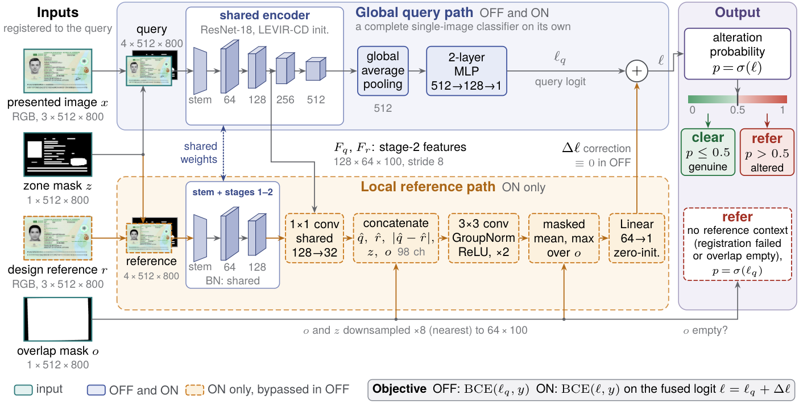
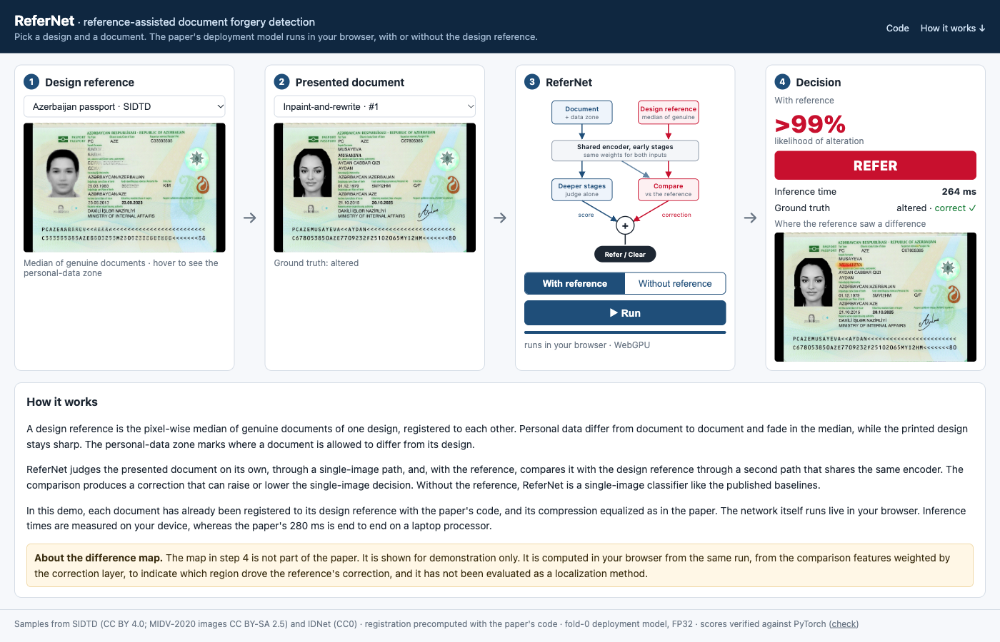

# The Difference a Reference Makes: Reference-Assisted Document Forgery Detection for Border Control

_Hamza A. Abushahla, Ariel Justine N. Panopio, and Dr. Mohamed I. AlHajri_

This repository contains the code and resources for our paper, **The Difference a Reference Makes: Reference-Assisted Document Forgery Detection for Border Control**, submitted to the GDRFA Dubai Scientific Research Award (second cycle, Digital Innovation Award). It includes the implementation of ReferNet, the three evaluation protocols, the records behind every result in the paper, and an interactive browser demo.

🌐 **Live demo:** [7abushahla.github.io/ReferNet](https://7abushahla.github.io/ReferNet/)

<div align="center">
  
</div>
<p align="center"><em>Figure 1: Our proposed architecture, ReferNet. The upper row is the global query path, used in both conditions. The dashed lower row is the local reference path, which shares the encoder weights, is live only in ReferNet (ON), and adds its correction Δℓ to the query logit ℓ<sub>q</sub>.</em></p>

## 📌 Overview

At passport-control counters and smart gates, officers must clear or refer a document within seconds. Referrals are costly: of the 20,307 travel documents that Dubai's Document Examination Center examined between January 2025 and June 2026, only 902 were altered, and **95.6% were genuine**. Deep-learning detectors can help, but they judge a document on its own and lose accuracy on designs they were not trained on.

**ReferNet** detects document forgery by comparing the presented document with a **genuine reference of its design**, the pixel-wise median of genuine documents of that design. A Siamese-based network judges the document on its own through a global query path and corrects that judgment through a local path that compares it with the reference, while a personal-data zone tells the comparison where legitimate differences are expected. A new design is handled by adding its reference, without retraining. The main contributions are:

- We propose **ReferNet**, a DL-based framework that compares a presented document with a genuine same-design reference, enabling zero-shot forgery detection on new designs without retraining.
- We benchmark the framework under three progressively challenging protocols. Results reach up to **93.9%** accuracy and **97.7%** AUC on seen designs, **88.83%** accuracy and **93.9%** AUC on unseen designs within SIDTD, and **82.25%** accuracy and **95.9%** AUC in zero-shot transfer to IDNet.
- We isolate the reference's contribution through matched comparisons and examine compression cues and attack families.
- We estimate that ReferNet would cut the referrals of Dubai's DEC by **94.0%**, **69.8%**, and **89.0%** on seen designs, unseen nationalities, and unseen designs, at **280 milliseconds** per document on a laptop.

---

## 📊 Key Results

| Protocol | Setting | Accuracy (up to) | AUC (up to) | Estimated cut in DEC referrals |
|---|---|---|---|---|
| **A** | Seen document designs (SIDTD) | 93.9% | 97.7% | 94.0% |
| **B** | Unseen nationalities within SIDTD | 88.83% | 93.9% | 69.8% |
| **C** | Zero-shot transfer to IDNet (eight designs) | 82.25% | 95.9% | 89.0% |

Accuracy and AUC are the best fold, group, or design. The referral estimates apply the mean measured error rates (fixed threshold, compression equalized) to the 20,307 documents examined by the DEC. Inference takes **280 ms** per document end to end on a laptop CPU (Intel Core i7-12700H, 4 threads, FP32).

---

## 🖥️ Interactive Demo

The [demo](https://7abushahla.github.io/ReferNet/) runs the paper's fold-0 deployment model in the browser with ONNX Runtime Web (WebGPU, or WebAssembly where WebGPU is unavailable). Pick a design reference and a document from SIDTD or IDNet, choose whether ReferNet uses the reference, and see the likelihood of alteration, the decision (refer or clear), the inference time on your device, and, with the reference, where the comparison saw a difference.

<div align="center">
  
</div>

The samples come from the paper's locked fold-0 test predictions, so none was seen in training, and their registration to the design reference is precomputed with the paper's code. [`verify.html`](https://7abushahla.github.io/ReferNet/verify.html) checks that every score computed in the browser matches PyTorch. The difference map is shown for demonstration only and is not part of the paper.

---

## 📁 Repository Structure

- `src/`: the implementation
  - `models/`: ReferNet (`direct_reference.py`), the ResNet-18 encoder initialized from ChangerEx (`anchor_changer.py`, `changerex.py`)
  - `data/`: rectification to the 512×800 input, registration, design references and personal-data zones, compression re-encoding, protocol datasets
  - training, evaluation and metrics (`*_train.py`, `evaluate.py`, `metrics.py`, `policy_metrics.py`)
- `configs/`: training and protocol configurations
- `scripts/`: data preparation, training and scoring drivers, benchmarks (`bench_cpu_deploy.py` measures the inference time)
  - `cluster/`: environment setup, data staging and launchers for each protocol
- `results/`: result tables, locked predictions behind every table, timing records, figures
- `demo/` and `site/`: the tools that build the browser demo and the demo itself (GitHub Pages)
- `tests/`: unit tests for the data pipeline, model, protocols and demo tools
- `data/`: dataset folders (not committed; see [`data/README.md`](data/README.md))
- `docs/`: data decisions, conventions and design notes
- `proposal/`, `experiments/`, `sweeps/`, `notebooks/`: the research proposal, experiment notes, generated launchers and exploration

---

## 1) Environment

```bash
git clone https://github.com/7abushahla/ReferNet.git
cd ReferNet
conda env create -f environment.yml
conda activate refernet
```

## 2) Data

The study uses two public datasets of synthetic identity documents:

- **[SIDTD](https://github.com/Oriolrt/SIDTD_Dataset)**: ten designs (five passports and five identity cards), with inpaint-and-rewrite and copy-and-replace forgeries. CC BY 4.0, with the MIDV-2020 images under CC BY-SA 2.5.
- **[IDNet](https://arxiv.org/abs/2408.01690)**: twenty designs rendered by a separate generator, including in-place text replacement. CC0. Used for evaluation only.

`scripts/cluster/download_datasets.sh` downloads them, and `scripts/cluster/stage-data.sh` builds the processed inputs. Folder contents and sizes are listed in [`data/README.md`](data/README.md).

## 3) Reproducing the Experiments

Training and evaluation need a GPU. Prepare the data once:

```bash
bash scripts/cluster/stage-data.sh    # download the datasets and build data/processed
```

Each protocol has its own launcher in `scripts/cluster/` (`protocol_a_study.sh`, `protocol_b_study.sh`, `prepare_protocol_c.sh` and `score_protocol_c_v2.sh`). The inference time is measured with:

```bash
python scripts/bench_cpu_deploy.py --off <off/best.pt> --on <on/best.pt> --weights <weights.pth> --n 200 --threads 4
```

## 4) Rebuilding the Demo

```bash
python demo/export_onnx.py        # export the fold-0 OFF and ON checkpoints to ONNX
python demo/dump_inputs.py        # on a GPU machine: dump each sample's inputs and check them against the paper
python demo/build_site_data.py    # write site/manifest.json and the sample images
node --test site/tests/*.test.mjs
```

---

## Acknowledgment

This research was supported in part by the High-Performance Computing (HPC) environment at the American University of Sharjah (AUS). The authors acknowledge the AUS-HPC team for providing the computational infrastructure and technical support.
